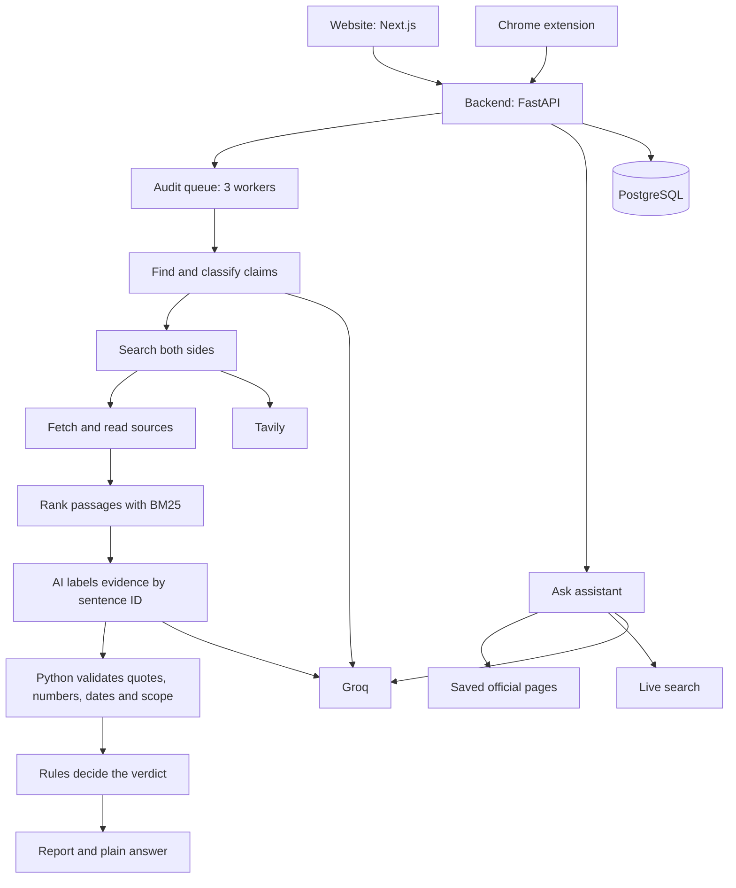

# Veritrace

Veritrace checks public claims about India against evidence, and helps citizens understand official information. It searches for proof on both sides, quotes the exact source text, and says plainly when the evidence isn't enough.

It was built for Theme 1, Civic Pulse: Digital Governance & Public Information.

## The Problem

False claims about schemes, rules and statistics spread faster than people can check them, and official information is often hard to find or understand. A chatbot alone isn't enough, because it can sound certain while being wrong.

Veritrace keeps the AI's role small and checkable. The AI reads and explains. Python checks every quote, and rules decide every verdict.

## What It Does

**Check a claim**

- Accepts pasted text, a URL, or text selected in the Chrome extension.
- Finds up to 3 factual claims, including yes/no questions, and skips opinions and predictions.
- Searches official sources and the open web, for support and for contradiction.
- Builds quotes from the saved page text, so the AI can't invent one.
- Gives one summary, with a result for each claim: Confirmed, Incorrect, Misleading, Unconfirmed or Sources disagree.
- Shows the live progress, an estimated time left, and a Cancel button.

**Ask about government information**

- Explains Indian schemes, policies, notifications, rights, public services and official statistics.
- Searches saved official pages, then live official sites, then the wider web, and labels which one answered.
- Answers follow-up questions, and questions about one linked notification or PDF.
- Refuses unrelated questions, and says so when it can't find an answer.

**Chrome extension**

- Right-click selected text to check it, with progress and the answer in a side panel.
- Includes the Ask assistant, a list of past audits, and links to full reports.

## Architecture



| Part | Technology |
|---|---|
| Website | Next.js, TypeScript, Tailwind CSS |
| Extension | Chrome Manifest V3 side panel |
| Backend | Python, FastAPI, asyncpg |
| Database | PostgreSQL, with full-text search for saved pages |
| AI | Groq, `openai/gpt-oss-120b`, with `openai/gpt-oss-20b` as backup |
| Search | Tavily |
| Page reading | trafilatura for HTML, PyMuPDF for PDFs |
| Passage ranking | BM25 |

### How verdicts stay trustworthy

| Step | Who decides |
|---|---|
| Finding claims and labelling evidence | AI, using strict output formats |
| Whether a quote is real | Python, as quotes are rebuilt from saved sentences |
| Numbers, dates, places and scope | Python |
| The verdict and confidence | Python rules |
| The plain-language summary | AI, and Python rejects figures that aren't in the sources |

A claim is settled by one official source, or by 2 separate publishers, which is capped at Medium confidence. Official means `.gov.in`, `.nic.in`, `.int` and a short list of bodies such as `rbi.org.in`. Social media never counts as evidence.

### Data sources

All results come from live services and real pages. The app has no mock or sample data.

- **Live search:** Tavily, which returns current web pages.
- **Direct fetching:** official and news pages, read when an audit runs.
- **Saved official pages:** real pages from RBI, MoSPI, PIB, ISRO, WHO, India Code and others, gathered by `scripts/seed_knowledge.py`.

## Setup

See [RUN.md](RUN.md) for full steps.

```powershell
cd backend
python -m venv .venv
.venv\Scripts\activate
pip install -r requirements-dev.txt
uvicorn main:app --port 7860 --workers 1 --env-file ../.env
```

```powershell
cd frontend
npm install
npm run dev
```

Open `http://localhost:3000`.

## Environment Variables

Copy `.env.example` to `.env`. Never commit `.env`.

| Variable | Required | Purpose |
|---|---|---|
| `GROQ_API_KEY` | Yes | AI calls |
| `TAVILY_API_KEY` | Yes | Web search |
| `DATABASE_URL` | Yes | PostgreSQL connection. The database must use UTF-8 |
| `GROQ_MODEL` | No | Main AI model |
| `GROQ_FALLBACK_MODEL` | No | Used when the main model's daily limit runs out |
| `FRONTEND_ORIGIN` | No | Website address allowed by CORS |
| `DAILY_AUDIT_LIMIT` | No | Shared daily limit for checks and answered questions |
| `TAVILY_MONTHLY_CREDITS`, `TAVILY_CREDIT_RESERVE` | No | Stops new audits before credits run out |
| `REPORT_REUSE_DAYS` | No | How long a saved report can be reused |
| `ENABLE_SKEPTIC`, `ENABLE_SOURCE_HISTORY` | No | Optional steps |
| `FACT_CHECK_API_KEY` | No | Google Fact Check Tools |

The website uses `NEXT_PUBLIC_API_URL` in `frontend/.env.local`.

## API

| Method | Endpoint | Purpose |
|---|---|---|
| `POST` | `/api/audits` | Start a check |
| `GET` | `/api/audits/{id}` | Get status, time estimate and report |
| `GET` | `/api/audits/{id}/events?after_id=0` | Get live progress |
| `POST` | `/api/audits/{id}/cancel` | Cancel a running check |
| `POST` | `/api/chat` | Ask a question |
| `GET` | `/api/chat/status` | Get saved page count and uses left |
| `GET` | `/api/health` | Get health and uses left |

The API has no way to list audits. Each browser keeps its own list.

## Tests

```powershell
$env:TEST_DATABASE_URL = "postgresql://user@localhost/veritrace_test"
pytest
```

Tests use a scripted AI, search provider and web server, so they make no external calls. The test database is wiped on each run.

## Evaluation

These results come from one early live test of 10 claims, with expected verdicts written before the run. They show behaviour on a small sample, not general accuracy.

| Measure | Result |
|---|---|
| Expected verdict reached | 8 of 10 |
| True claim marked Contradicted, or false claim marked Supported | 0 |
| Time per audit | 21 to 114 seconds |

Source rules, claim handling and verdict logic have changed since that test, so the current version hasn't been measured on fresh claims.

## Known Limitations

**Scope**

- There are no live social feeds, images, video or audio, knowledge graph, or deepfake detection.
- The extension checks selected text, not whole posts. Only the selection is used, so a fragment such as "It rose 8%" can't be checked.
- Only English sources are used, and scanned PDFs are not read.
- Source History shows the earliest source found, not the true origin of a claim.

**Accuracy**

- Two publishers aren't proof of independent reporting, because copied stories aren't always detected. Related sites can count separately.
- A claim stated as "likely" in a source can still count as support.
- Python confirms that a figure appears in a source, not that a sentence uses it correctly. AI-written answers can still misread a source.
- Keyword checks on dates, places and scope can miss subtle mismatches.
- "Yesterday" is resolved from today's date, so it can be wrong for older posts.
- The Ask assistant gives general information, not legal, medical or eligibility advice. Saved pages can be out of date.
- If a page can't be fetched directly, text from the search provider may be used. Reports label this, but it isn't checked against the live page.

**Operations**

- Audits can take a few minutes, and depend on Groq and Tavily being available.
- Free Groq limits are low, and all users share them. The backup model's accuracy hasn't been measured.
- One person can use the whole daily limit. Failed checks don't count towards it, but they still use AI and search credits.
- Audit links work for anyone who has them, so don't submit confidential text.
- Interrupted audits must be resubmitted. Only one backend worker is supported, because the queue is in memory.
- Cached search results are kept long-term for stable claims. Use Search again to refresh them.
- A small DNS rebinding risk remains, because connections aren't pinned to the validated IP.

## Roadmap

- Hindi and regional languages
- Screenshot text reading, then image history
- A ranked feed of spreading claims for fact-checkers
- Direct adapters for official data, such as World Bank and PubMed, plus Wikidata lookups
- Alerts when a rule or scheme page changes

## Credits

Built with FastAPI, Next.js, PostgreSQL, Groq, Tavily, trafilatura, PyMuPDF and rank-bm25.

AI coding tools were used to help plan, write and test this project during the hackathon.
